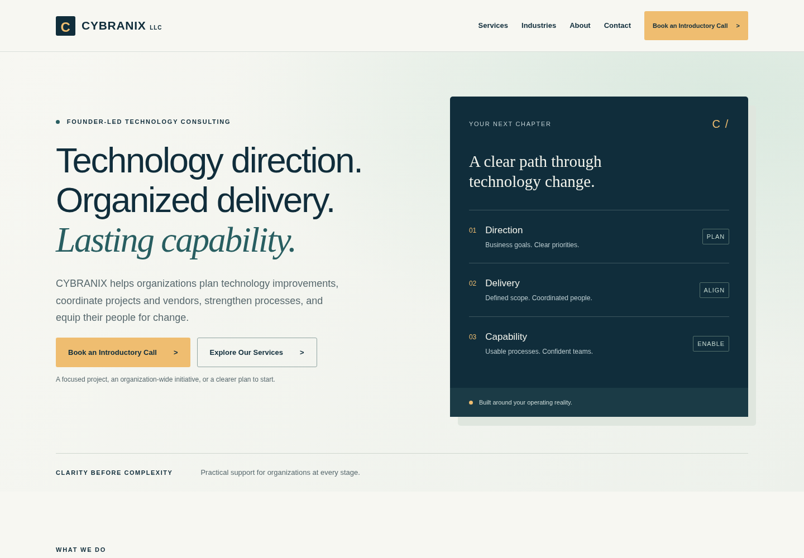

# CYBRANIX redesign — awaiting approval

The site is rebuilt around founder-led technology consulting for organizations across sizes and sectors. The design keeps the established navy, teal, amber, and CYBRANIX LLC identity.

## Preview



[Full homepage](docs/previews/home-full.png) · [Mobile homepage](docs/previews/home-mobile.png)

## Site map

- Home
- Services hub and six service pages: IT Strategy & Advisory; IT Project & Vendor Management; Cloud Planning & Provider Coordination; IT Operations & Process Improvement; Governance Documentation & Readiness Coordination; Technology Training & Enablement
- Industries hub and eight sector pages: Government & Public Sector; Healthcare & Life Sciences; Financial Services & Fintech; Consumer Goods & Retail; Manufacturing & Distribution; Professional Services; Education & Nonprofits; Other Sectors & Organizations
- Business IT Review: fixed-scope operational review and prioritized 90-day roadmap
- About: Theo Ilevbare and founder-led approach
- Contact: introductory-call request by email, with working telephone link
- Earlier `government.html` URL retained as a gateway to the government industry page

Sector pages explain potential service applications. They do not claim clients, partnerships, experience, certifications, or regulatory expertise in each sector. Unverified performance figures and credentials from the supplied guide are omitted. Managed monitoring, 24/7 support, advanced engineering, coding, security audits, and compliance certification are not advertised.

## Maintain and preview

Static HTML and CSS need no build service or dependencies to run. Edit `tools/build_site.py` for page content and shared navigation, then run:

```sh
python3 tools/build_site.py
python3 tools/check_site.py
python3 -m http.server 3000
```

Open the server URL on the same computer. Generated pages use relative links and directory index files for GitHub Pages and project-subpath compatibility. Keep generated pages committed. Edit `styles.css` for design changes. Original hero asset is preserved but unused to reduce page loading weight.

## Validation

- 21 pages: local links, fragment targets, unique IDs, language, metadata, one main landmark and h1, contact links, and content constraints pass.
- 84 browser page/viewport checks at 320, 375, 768, and 1440 pixels: no horizontal overflow or HTTP errors.
- Browser navigation through service pages and introductory-call action passes. Keyboard skip-link focus passes.
- Desktop homepage screenshot visually inspected; mobile and full-page captures included for review. These checks are not a full accessibility audit.
- `git diff --check` passes.
- CNAME byte-for-byte unchanged; existing GitHub workflow files unchanged.
- Authenticated Pages settings verified: legacy build from `main`, root path `/`, HTTPS enforced, custom domain `cybranixsystems.com`.

## Release status

Development branch only. No merge, deployment, DNS edit, or Pages setting change is authorized by this review draft.

The booking action opens an email request; it does not automatically reserve a meeting. No booking service URL has been supplied. Pricing, engagement timing, and scope are agreed directly.

Review the screenshots and copy before approving a merge to `main`. A merge may trigger the existing GitHub Pages production deployment.
